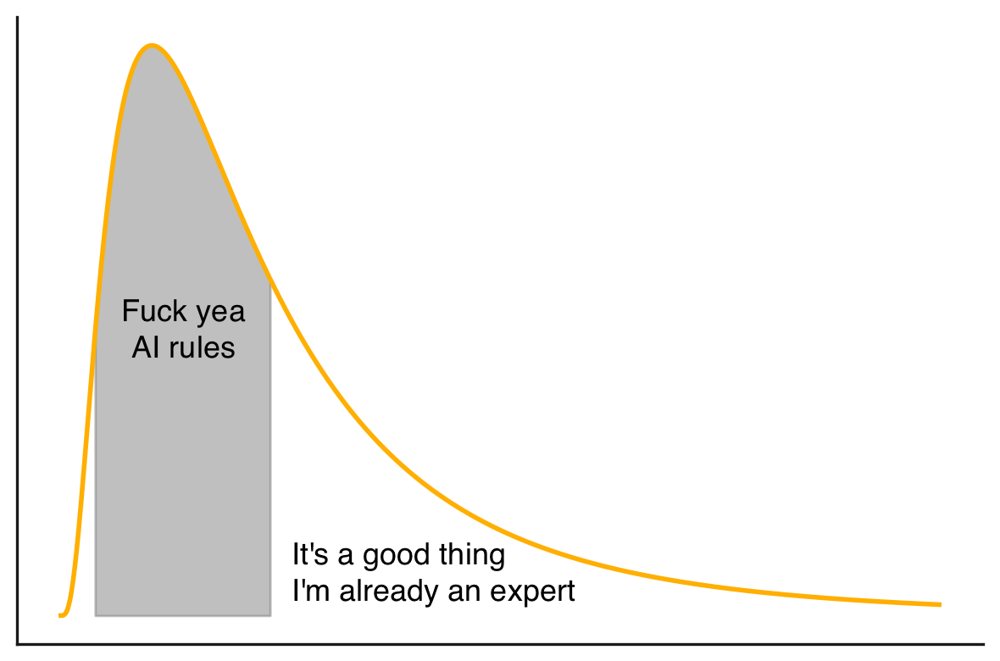

+++
title = "Your boss is being taken for a ride on Generative AI"
date = "2025-06-21T18:11:00Z"
draft = false
[taxonomies]
tags = ["education", "generative-ai", "management", "tools"]
categories = ["Business", "Technology"]
+++

You know how it's pretty easy to spot an online post or comment that was written
with ChatGPT? It's not that they use em-dashes—_plenty_ of great writers use
em-dashes—it's that they have a general air of disconnectedness and they write
with a patronizing, prescriptive structure. It's easy to spot most AI slop.

However, I am cognizant of survivorship bias. There is a lot of AI-generated
content that slips by unnoticed. If you have a strong command of both your
subject matter and written prose you can prompt your way to a high-quality
output, but in order to do that you have to give it more than it gives back.
It's a lopsided, toxic relationship, and these days there are a lot of lovesick
people out there.

Unfortunately, your boss is one of those sad saps standing on the curb with
nothing but a bouquet of flowers and a dream.

---

In my mind there are three different types of tasks that we might get a
Generative AI tool or "Agent"[^agent] to do for us:

1. There is little disagreement that Generative AI is bad at anything that might
   loosely be described as art, which I'll define for myself as anything unique
   that is created with a mixture of curiosity, imagination and craftsmanship.
2. Generative AI is great at tasks and processes that require no imagination,
   like extracting structured data from written text, summarizing a transcript,
   or repetitive clerical tasks.
3. Generative AI _might_ be good at domains like programming or law, which can
   span a massive spectrum between the utterly routine and the very incarnation
   of elegance.

The third category is the most interesting to me. There are wildly divergent
opinions on the utility (or futility) of Generative AI for programming. The
world of bits and bytes can be intractable because what you build is limited
only by the guardrails of your imagination. The substrate is what you decide it
is. The raw materials are undefined until you declare them.

In the physical world of atoms, we have a general idea of the forces, chemicals
and components that we need to build a bench, a bridge or an airplane. That
isn't to discount the expertise required to build those things, I note only that
there is an inherent tactile structure to building things in physical space that
doesn't exist in the digital one. Things fit together, or they don't. Most
failure modes are known in advance, unlike the sly bugs that lie in wait within
every digital codebase.

Because it is not grounded in the physical world, software complexity fits a
fat-tailed distribution. A lot of applications follow the tried and true recipe
of reading and writing information to a database with a bit of business logic
and reporting mixed in. The techniques for creating such an application are well
documented and well understood, and this is the sort of thing that Generative AI
can do very well with little correction or oversight on the part of the
operator. For this reason, prototyping greenfield projects is a great use of the
technology.

As we navigate further to the right on our fat-tailed distribution of software
complexity, we quickly enter a different world. Any piece of software is
comprised of layers—each layer building upon the layer below it, disconnected
from and naive to the specific implementation details underpinning it. This is
called abstraction and it's a foundational concept in programming. In simple
software we might be coding at just one layer of abstraction above a
well-documented framework that the Generative AI is pre-trained on. But in
complex and/or mature software, we've already written a few layers of our own,
and the AI hasn't been trained on the building blocks we're asking it to use.

I believe most of the disparity in lived experience with Generative AI among
software developers can be explained by plotting their work on this approximate
log-normal (fat-tailed) distribution. I suspect this shape holds true in many
other professional domains as well.

<figcaption>Complexity extends rightward. Most AI evangelists either have misaligned incentives or work on
    simple projects (denoted by the gray-shaded area).</figcaption>

It is possible to get a modern Generative AI to work on complex projects in the
tail part of the graph, but it needs much more attention and guidance. That is,
the operator needs to know _both_ the subject area extremely well, and the
nuances of the Generative AI tool extremely well. Obtaining a positive outcome
at this end of the chart is a difficult skill to master in itself, with novel
risks and pitfalls. In many instances it is faster and less error prone to write
the code yourself, since you will need to step in and course correct the AI a
lot. There is ample value in certainty, and you forego that at the outset. If
you don't have the expertise to identify its missteps (and there will be many),
then you are firmly out over your skis. You can see how frustrating this is for
everyone involved in real time: take a look at
[Microsoft's own engineers losing their minds trying to get AI to write correct code for them](https://github.com/dotnet/runtime/pull/115762)
(also [here](https://github.com/dotnet/runtime/pull/115743),
[here](https://github.com/dotnet/runtime/pull/115733) and
[here](https://github.com/dotnet/runtime/pull/115732)).

---

Your boss has been sold a grand lie. It's not their fault. They have been set
adrift in a sea of misdirection, misaligned incentives, grift, absolutism,
desperation, and stupidity. I have never seen a manic hype cycle like this one
and neither have they.

ChatGPT came along just as 15 years of free money dried up, leaving an
overweight tech industry clamoring for something, anything to keep the capital
spigot flowing. Not only could Generative AI create an entirely new class of
products and start-ups, it could also be used as cover to lower headcounts and
put those pesky, overpaid software developers back in their place.

So the salespeople started buying seafood towers and the scrum masters scrummed
with renewed vigor, and every downstream middle-manager through C-suite
executive were convinced that they didn't just want AI... they _needed_ AI.
There's an AI button on your keyboard now. `notepad.exe` has Copilot built in.
There's no budget for anything without AI. If you don't use AI, don't bother
showing up on Monday.

To state the quiet part out loud, the promise of Generative AI is "efficiency",
and "efficiency" simply means doing the same amount of work with fewer people.
So if you came to this post wondering if your job is at risk, the answer is
probably yes, but not because of AI—because your boss has been pumped full of
hot air.

Your boss has been told that an AI "Agent" is equivalent to a person. That you
can set it on a task, and with enough iterations of the loop, it will arrive at
the correct solution/feature/output. They've been told that their competitors
have many such tools and "Agents". They've been told they're falling behind.
They can't know it for sure, and they can't dispel it, but everyone is saying
it, including their own boss, and their boss's boss, and those well-dressed
chaps on that panel last week. It's not your boss's fault, they just have to to
keep up with \<dastardly competitor\>, who no doubt is using _Workday: the
powerful AI platform that keeps your most important assets on track, every
decision on point, and your fleet of AI agents at peak performance. That’s
Workday._&copy;

Jesus Christ.

The reality is this: **in order to apply Generative AI to a task, there needs to
be a human operator in the loop who understands that task BETTER than the AI**.
The classic adage of "garbage in; garbage out" applies. You cannot take someone
who lives on the median of the distribution in the chart above, give them a
replit account, and expect top-tier output.

The upper bound on what your company can accomplish with Generative AI is the
level of your most proficient colleague. It is as true in 2025 as it was in 2020
as it was in 1820: you cannot do great things without great people. What you
_can_ now accomplish are more middling things with the same amount of great
people. That has business value, to be sure. There is plenty of middling work
that needs to be done.

Now, I have no empirical basis for these numbers aside from my own experience
and intuition, but if I'm being VERY generous I would peg my own efficiency
improvements using Generative AI at somewhere around 20% to 30% on average. On
prototyping and side projects, I'd guess that I'm approaching 100%, but that's
not real work. On my mature main project and its components, the improvement is
well below 10%. Your mileage may vary depending on your mix, but it's not a
human ass in a human seat, that much is true. I would estimate that an
AI-forward company could drop a single junior developer for every 3 or 4 senior
developers, which would be on the order of a 10% to 15% reduction in
compensation expense in the base case of a company with only 4 or 5 employees,
all but one of them senior. The savings would be well below 10% in a larger,
more balanced pool.

---

How might you protect yourself from the whims of your stupid, gullible boss who
hasn't been enlightened by my napkin math? This hype cycle will crash in due
time as they all do, but Generative AI isn't going to uninvent itself. Our
environment has indeed changed, so it's time to adapt.

If my assertions prove correct, it will be the mundane work that ultimately gets
carved out and handed off to an AI under the supervision of an _overqualified_
operator. This runs counter to the current narrative that you can have average
people accomplish above-average things with AI, but I don't think that's how it
will shake out (much to the chagrin of MBA consultants everywhere, themselves
rather average).

If you're already in that "skilled operator" category and using Generative AI to
expedite your more menial work, continue advancing your ability to use the tools
but remember not to let your basic skills atrophy. I can say my spelling is far
worse now with the ubiquity of spell-check than it was in grade school.
Likewise, how many people can still parallel park under pressure without a
backup camera, or navigate across town without GPS navigation? Take your cue
from the aviation industry where pilots regularly fly manually despite
auto-pilot to keep their skills up.

If you're starting out, that's a trickier spot to be in, but it's not
impossible. Lean into fundamentals and keep your pencil sharp, because there
will always be a place for the person who actually understands the code that is
deployed, and that will only amplify in the future. Your colleagues or
classmates are all learning to ride a motorcycle before they know how to pedal a
bicycle. Learn how to pedal the bike.

I stated early on that art is safe. I believe that will always be true because
art is how we express humanity. It is the antithesis of machine. There may be no
artistry apparent in your day job, but curiosity, craftsmanship and imagination
are the ingredients of mastery no matter what you do. An AI agent cannot
replicate your taste. It has none of your flourish or flair. It has no style. It
is not cool.

If you're a programmer, recognize that programming is design. If you're a
labourer, approach your job like an engineer. If you're an engineer, approach
your job like an architect. Carve your name into your work and you'll be
alright.

<!-- more -->

---

[^agent]:
    The industry defines an Agent as a language model that can iterate on it's
    own output (runs in a loop) and use tools. Personally, I define an agent by
    its correct definition of something or someone that acts on behalf of
    something or someone else. The agent works for you, not in place of you.
